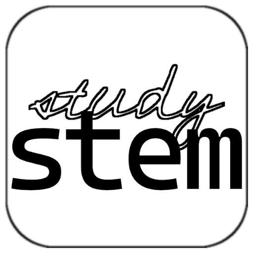

# Study STEM

Hello! 👋

My name is Vladimir, and I am from the Far East of Russia. I am interested in math, CS, competitive programming, and AI development. Also, in my free time, I do Arduino electronics, 3D modeling, chemistry, and physics.

- [Study STEM](#study-stem)
  - [The reason this site exists](#the-reason-this-site-exists)
  - [The Site](#the-site)
  - [Navigation](#navigation)
  - [Contributing](#contributing)
    - [I want to discuss/comment an existing page](#i-want-to-discusscomment-an-existing-page)
    - [I have found a typo/bad English](#i-have-found-a-typobad-english)
    - [I have an idea for an article](#i-have-an-idea-for-an-article)
    - [I want to publish my own article here](#i-want-to-publish-my-own-article-here)
  - [Code of Conduct](#code-of-conduct)
  - [License](#license)
  - [Privacy Policy](#privacy-policy)

## The reason this site exists

Before I started this site, I had some problems with socialization. I truly wanted to express at least a bit of everything that is important to me. At first, I was thinking about starting a Telegram channel, just like my friend did. But then I understood that it didn't suit me. The lack of LaTeX formulas, the inability to organize content into thematic groups, and the need to buy Telegram Premium — all of these made me think of creating my own site where I could freely share my ideas in different fields of science and art.

## The Site

The name — Study STEM — expresses the main goal: to learn new things in:

<ul>
    <li>Science fields.</li>
    <li>Latest Technologies.</li>
    <li>Advanced Engineering, whether it be pure code or real stuff.</li>
    <li>Pure and applied Mathematics.</li>
</ul>

This pretty cool description, which I formulated after a long search for the right words, goes like this:

> A digital garden of math, computer science, 3D modeling, electronics, and curious ideas.

Thus, all of this culminated in the final product which you are using right now. Here, I am posting my curious ideas as articles with illustrations — just like a web booklet.

## Navigation

Currently, you are on the main page. In the sidebar, you can open any of the published articles, as well as the news feed and other documents.

> Explore articles, have fun, and enjoy. Honestly, you don't even need to finish reading this page. After all, this was all done specifically for you — the readers.

## Contributing

Quick info:

- [Project's GitHub](https://github.com/VEFrenovator/study-stem)
- [Issues page](https://github.com/VEFrenovator/study-stem/issues)
- [Pull requests page](https://github.com/VEFrenovator/study-stem/pulls)
- [Discussions page](https://github.com/VEFrenovator/study-stem/discussions)
- [My email](mailto:vladimir_e11@outlook.com)
- [My GitHub profile](https://github.com/VEFrenovator)

### I want to discuss/comment an existing page

Unfortunately, the site itself does not support commenting, and all live discussions have been migrated to the [Project's GitHub](https://github.com/VEFrenovator/study-stem). So, welcome to the [Discussions page](https://github.com/VEFrenovator/study-stem/discussions). There you will find a thread for each article; if one doesn’t exist yet, feel free to create your own.

### I have found a typo/bad English

It happens... English isn't my native language. On the [Issues page](https://github.com/VEFrenovator/study-stem/issues), create a new issue (you can use the `bad-english` template) or suggest a correction using the [Pull requests page](https://github.com/VEFrenovator/study-stem/pulls).

### I have an idea for an article

Tell me more about it in the [Discussions page](https://github.com/VEFrenovator/study-stem/discussions) or send me an [email](mailto:vladimir_e11@outlook.com).

### I want to publish my own article here

What a bright idea! Create a pull request with its content or send me an email about it.

***

I genuinely welcome any and all feedback. Feel free to open an issue, submit a PR, join the conversation in the Discussions section, or reach out to me personally via email.

## Code of Conduct

The full Code of Conduct, and how to enforce it, can be found at https://vefrenovator.github.io/study-stem/#/CODE_OF_CONDUCT.

## License

Licensed under the MIT License. Copyright © 2026 VEFrenovator. For the license text, see https://vefrenovator.github.io/study-stem/#/LICENSE.

## Privacy Policy

This site uses Google Analytics 4 to collect anonymous usage data. You can read the full Privacy Policy and Google Analytics disclosures at https://vefrenovator.github.io/study-stem/#/privacy_policy.